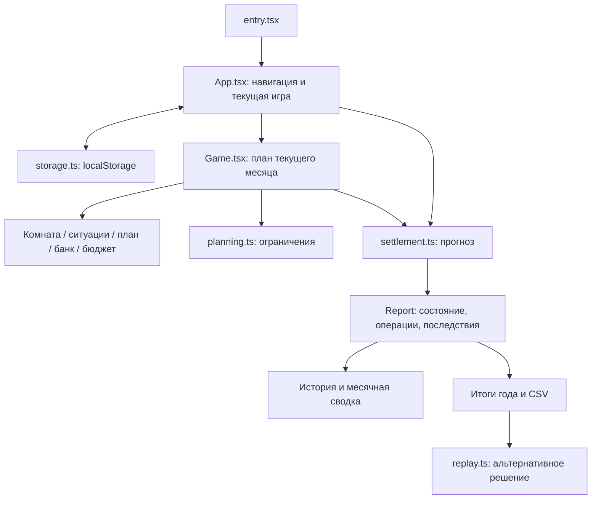

# Как устроена игра

Интерфейс работает в браузере, а модель — в обычных TypeScript-функциях. Расчёты не зависят от React, DOM и сети, поэтому их можно проверять отдельно.

## Путь от запуска до отчёта

`App` хранит текущую партию и завершённые месяцы. `Game` хранит ещё не принятый план: при изменении ползунка или выборе действия он вызывает прогноз, но не списывает реальные игровые деньги. При подтверждении `App` проверяет список выпавших ситуаций, закрывает месяц и сохраняет результат.

Незавершённый план, как и раньше, находится в состоянии React и не записывается в сохранение. Перезагрузка восстанавливает последний завершённый месяц. Настройки движения и света комнаты хранятся отдельно.

## Модель

Общий импорт для интерфейса — `source/lib/game.ts`. Это короткий список экспортов из специализированных модулей; формул в нём нет.

| Модуль в `source/lib/game/` | Ответственность                                                              |
| --------------------------- | ---------------------------------------------------------------------------- |
| `types.ts`                  | Форма состояния, плана, отчёта и ситуации                                    |
| `config.ts`                 | Уровни, цели, старт, жильё, работа, кредитные предложения, экономика месяцев |
| `situations/`               | 60 авторских ситуаций и их варианты                                          |
| `situations.ts`             | Поиск ситуации и решений по постоянным идентификаторам                       |
| `schedule.ts`               | Воспроизводимое распределение 1–3 ситуаций на месяц                          |
| `furniture.ts`              | Покупки, инвентарь, помощь и подарки                                         |
| `finance.ts`                | Капитал, долг, базовые расходы, кредитные платежи                            |
| `planning.ts`               | Исходный план, часы и ограничения                                            |
| `evaluation.ts`             | Баллы и условия достижения цели                                              |
| `settlement.ts`             | Единственный расчёт результата месяца                                        |
| `replay.ts`                 | Пересчёт истории с изменением одного выбора                                  |
| `utils.ts`                  | Денежное округление, ограничение показателей, копирование и формат чисел     |

Идентификаторы ситуаций и полей сохранения — часть формата данных. Их не следует переименовывать при редактировании текста сюжета. `situations/legacy.ts` нужен для чтения старых сохранений с фиксированными помесячными историями; эти ситуации участвуют и в общем случайном наборе.

## Почему важен порядок расчёта

В `settlement.ts` месяц проходит последовательные этапы:

1. Проверка плана и копирование входных данных. Предыдущий месяц и исходный план не изменяются.
2. Процент на входящий остаток накоплений, снятие денег, продажа фонда и раскрытие изменения рынка для оставшейся доли.
3. Наступившие отложенные события, старые кредитные платежи, стоимость прошлого дефицита, выдача нового кредита и его комиссия.
4. Поддержка, стипендия, работа, жильё, продукты, транспорт и личные траты.
5. Выбранные ситуации, новые обязательства, покупки и подарки для комнаты.
6. Пополнение накоплений и покупка фонда в пределах доступных денег.
7. Раскрытие скрытых потерь при завершении месяца, пересчёт учёбы, ресурса, навыков, безопасности и итогового отчёта.

Новые пополнения приносят доход со следующего месяца. Купленная мебель помогает с будущего месяца; её стоимость не увеличивает финансовый капитал. В прогнозе скрытые потери и текущий результат рынка не раскрываются. Эти правила общие для прогноза, закрытия месяца и альтернативной истории.

## Представление и данные сюжета

Смысл и последствия решений хранятся в `game/situations/`. Визуальные реплики, предметы и реакции описаны в `story-scenes.ts` и `story-presentation.ts`. `locations.ts` выбирает одну из 16 локаций. React-компоненты `StoryScene`, `StoryObjects` и `SceneEnvironment` показывают эти данные и передают выбранный идентификатор обратно в план.

Рисунок комнаты находится в `PlayerRoomArt`; клики, список действий и магазин — в `PlayerRoom`. Расчёт стоимости и помощи мебели остаётся в модели, а не в SVG.

## Сохранение и сборка

`storage.ts` читает старый формат, подставляет отсутствующие настройки персонажа и сложности и восстанавливает расписание будущих ситуаций. Ошибка JSON или запрет доступа к хранилищу не мешает открыть приложение. Запись возвращает `false`, если браузер не смог сохранить данные; интерфейс показывает сообщение.

`build.mjs` собирает React и модель через esbuild, затем встраивает CSS, шрифт, логотипы и персонажей в один `index.html`. Сжатие JavaScript относится к этому результату сборки. Все редактируемые исходники в папке `source` остаются развёрнутыми.

Порядок CSS перечислен в `STYLESHEETS`: сначала исходная база и служебные правила, затем тема, оформление экранов, ситуаций, анимаций и комнаты. При разделении файлов порядок оставлен прежним, чтобы не менять внешний вид.
